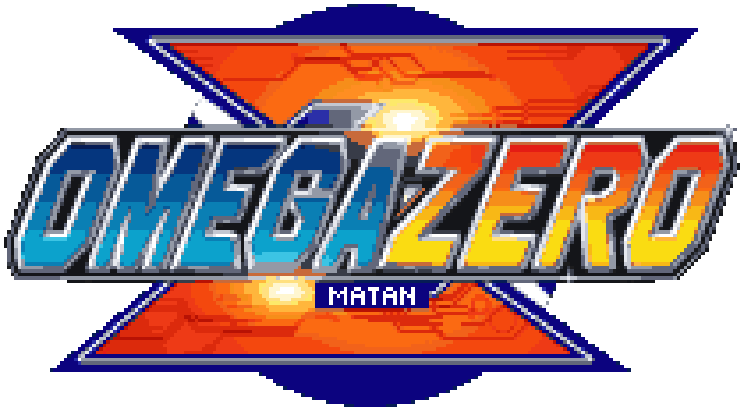

<h1 align="center"></h1>

A Game Boy-centric frontend for Anbernic H700 handhelds running
<a href="https://github.com/pvaibhav/BaseOS">BaseOS</a>. It plays GBA, GBC and GB games, and SNES,
PlayStation and PSP games too, on a shelf of cartridges, discs and UMDs that go down into the
handheld when you play them.

<a href="https://oauramos.github.io/omega-zero/"><b>Site</b></a> ·
<a href="https://github.com/oauramos/omega-zero/releases/latest"><b>Download</b></a> ·
<a href="https://github.com/oauramos/omega-zero/wiki"><b>Wiki</b></a> ·
<a href="CHANGELOG.md"><b>Changelog</b></a> ·
<a href="README-FORK.md"><b>Fork changes</b></a>

## About this fork

This fork of omega-zero 1.2.0 brings back [Slot](https://github.com/BrandonKowalski/slot)'s
controls and conveniences and adds RetroAchievements, drawn in omega-zero's own style:

- **Slot's buttons**: MENU opens Settings on the shelf and the in-game menu in a game, START
  picks the core, Y adds a favorite, and holding POWER powers off.
- **Favorites and Recents** shelves, with a star on every favorite, kept in Slot's own files.
- **A screen filter**: LCD, Grid or Off, also on SELECT + A / B in a game.
- **Slot's other settings**: Load State on Insert, Save State on Eject, Rewind, Turbo, Frame
  Blending, Game Boy palettes, Game Titles, 12-hour clock, Lid Power Off and Fast Forward OFF.
- **A default core for each system**, with the games switched by hand put back in one press,
  and the boot animation off unless switched on.
- **Updates on the console**: Settings › Update fetches the latest release from GitHub, where
  every version bump is tested, built and released by GitHub Actions.
- **Slot's in-game menu**: Resume, Undo Save / Load, States, Settings, Restart and Exit Game.
- **RetroAchievements** for Game Boy, Game Boy Color, GBA, SNES and PSP games, signed in on the
  keyboard, with hardcore, and an in-game page showing the game it was matched to and every
  achievement. Sign-in retries until Wi-Fi is up, and unlocks earned offline are sent later.
- **Slot's `cart_shell.txt`** is read, clear shells look clear with a board, chips and a battery
  inside, and labels load first for the carts on screen. Clear and glitter carts have a holo
  sheen on their label, as on a holographic Pokémon card.
- **Link play online and on the LAN** for GBA games on gpSP, through RetroArch's netplay: with
  RetroArch on a PC on the same Wi-Fi, or with anyone online through RetroArch's lobby and
  relays, rooms with passwords and all, as well as handheld to handheld.
- **Save Backup**: every save copied to a folder on your NAS over Samba as it is made, kept until
  the NAS can be reached when it cannot, the NAS found on the Wi-Fi and the folder picked or
  made from the handheld.
- **Run-Ahead** on gpSP: a press answered a frame sooner.
- **START while holding POWER restarts**, and the shelf comes up on the game it was on.

Everything, with defaults and the files kept on the card, is in **[README-FORK.md](README-FORK.md)**.

## Supported devices

One build runs on all of them: omega-zero reads the model from BaseOS at boot and lays itself out
for its panel.

| Device | Panel | Status |
|---|---|---|
| RG35XX SP | 640x480 | Main target, in daily use |
| RG SP | 720x480 | Supported, not yet retested on hardware |
| RG34XX SP, RG34XX | 720x480 | Untested |
| RG35XX Plus / 2024, H, Pro | 640x480 | Untested |
| RG40XX H, RG40XX V | 640x480 | Untested |
| RG CubeXX | 720x720 | Experimental |
| RG28XX | 480x640, turned | Experimental |

Own an untested one? A [device report](https://github.com/oauramos/omega-zero/wiki/Device-Reports)
is the most useful thing you can send.

## Highlights

- A shelf for each system, modelled low-poly and drawn the way a PlayStation drew 3D, with real
  label scans: Game Boy carts in their own plastics, SNES carts in the American shape for a game
  from the USA and the Super Famicom's for the rest, PlayStation discs, a game on several
  discs standing as a stack of them, and PSP UMDs: a round-topped shell with the disc's label
  showing through its clear window, catching the light in rings as it sways, the way a CD does. The one you are on floats and sways; A pulls it down out of
  the screen into the handheld, and the game comes on like a tube TV. At power-on, an opening in the
  style of Mega Man X5's boot terminal tells you the handheld's memory, chip and battery, then
  fades into the shelf.
- Six cores: mGBA and gpSP for the GBA and Snes9x and Supafaust for the SNES, chosen per cart;
  mGBA for the Game Boys; PCSX ReARMed for the PlayStation, with a BIOS of its own built in; and
  PPSSPP for the PSP, drawing on the handheld's GPU. GBA fills a 640x480 screen and the
  PlayStation fills it at 4:3; the SNES is drawn at twice its size, and Game Boy stays at 3x. A
  PSP game fills the screen's width (Fit), or shows at its own 480x272 or stretched, set in
  Settings > Gameplay > PSP Screen and for each game in its menu.
- The PSP's stick is the D-pad while L2 is held, or until L2 is pressed again, or never, set
  for each game in its menu (GAMEPLAY > D-Pad as Stick).
- A PlayStation game on several discs is one game: DISC, on SELECT+MENU in a game, puts another
  disc in, and the game resumes with the disc that was in the drive.
- Resume on boot, save states with a switcher, rewind (not on the PlayStation or PSP), fast-forward,
  and turbo buttons on the Game Boys.
- Link play between two handhelds over Wi-Fi, for Game Boy and GBA games: Pokémon trades,
  Advance Wars, Mario Kart and Tetris.
- Settings on MENU, in windows in the style of Mega Man Zero's menus that slide from screen to
  screen, over a background that keeps moving: CONFIGS (Fast Forward, Colour Correction, Screen
  Filter, Gameplay, Shelf, Labels) and GENERAL (Date & Time, Network, Bluetooth, Theme, About).
- A tap of SELECT opens CONTROLS: what every button does, on the shelf and in a game, on one panel.
- Network: home Wi-Fi, network time, and SSH and SFTP, each ON or OFF. Y on one opens its panel:
  SSH's shows the login and root's own random password. Labels are fetched from ScreenScraper,
  one for each disc of a PlayStation game, and a UMD's disc label for a PSP game.
- Bluetooth, on handhelds that have it: pair a device and connect it, or forget it. Game sound and
  gamepads over Bluetooth are still to come.
- Theme: the background's pattern, its motion and its colour, which the menus and both bars take
  (Night is grey, Amber is Mega Man Zero's own), and the bottom bar's font, Bold or Thin.
- A pixel font, a top bar with the radios, clock and battery, and a bottom bar with the buttons.

## Screens

 The RG35XX SP in 3D, drawn the way a PlayStation drew it, with omega-zero's own screens on it: the loops play on the <a href="https://oauramos.github.io/omega-zero/">site</a>

 Settings, in Night and in Amber

 Network and Bluetooth

 Theme, and CONTROLS on a tap of SELECT

## Quick start

1. Write the [BaseOS image](https://github.com/pvaibhav/BaseOS/releases/latest) for your model to a
   microSD card, put it in **SD1** and boot once.
2. Copy the contents of the [latest release](https://github.com/oauramos/omega-zero/releases/latest)
   to the root of that card.
3. Put your games in `Games/GBA`, `Games/GB`, `Games/GBC`, `Games/SNES`, `Games/PS1` and
   `Games/PSP`. A PlayStation game is a `.cue` with its `.bin`, a `.chd`, a `.pbp` or an `.m3u`;
   a real PlayStation BIOS, such as `scph5501.bin`, is used from `BIOS/` when it is there. A PSP
   game is an `.iso`, a `.cso`, a `.chd` or an eboot `.pbp`; its saves are kept in
   `Saves/PSP/SAVEDATA`, as on a memory stick.
4. Boot. On the shelf, MENU opens Settings and a tap of SELECT shows every button.

Two cards and updating are in the site's
[install guide](https://oauramos.github.io/omega-zero/#install); controls and everything else are
in the [wiki](https://github.com/oauramos/omega-zero/wiki).

## Credits and licence

omega-zero is made by **Otávio ([@oauramos](https://github.com/oauramos))**.

- Based on [slot](https://github.com/BrandonKowalski/slot) by
  [Brandon T. Kowalski](https://github.com/BrandonKowalski) (GPL-3.0). The code that hosts the
  cores, with their saves, sound and input, is still largely his.
- [BaseOS](https://github.com/pvaibhav/BaseOS) by pvaibhav.
- Emulation by [mGBA](https://mgba.io) (MPL-2.0) and [gpSP](https://github.com/libretro/gpsp)
  (GPL-2.0) for the Game Boys; [Snes9x](https://github.com/libretro/snes9x) (free for
  non-commercial use only) and [Supafaust](https://github.com/libretro/supafaust), Mednafen's
  snes_faust (GPL-2.0), for the SNES; and
  [PCSX ReARMed](https://github.com/libretro/pcsx_rearmed) (GPL-2.0) for the PlayStation; and
  [PPSSPP](https://www.ppsspp.org) (GPL-2.0) for the PSP. Their licences and patches, and the
  source of all but mGBA, ship in `System/licenses/`.
- Type is [Pixel Code](https://github.com/qwerasd205/PixelCode) by Qwerasd (SIL OFL 1.1); every
  icon is drawn as pixel art. The LCD mask is derived from GigaHerz's LCD3x.
- Cart labels come from [ScreenScraper](https://www.screenscraper.fr), fetched with your own
  account.
- This fork's achievements run on [rcheevos](https://github.com/RetroAchievements/rcheevos) by
  RetroAchievements.org (MIT); its controls, settings and in-game menu follow Slot's. See
  [README-FORK.md](README-FORK.md#credits-and-licences).

omega-zero is licensed under the GPL-3.0-or-later; see [LICENSE](LICENSE). It began in October
2026 as a modified version of slot. It is written with Claude, and reviewed and tested by its
maintainer. The site and these pictures are drawn with its
UI kit, [`assets/ui`](assets/ui).

Game Boy, Game Boy Color, Game Boy Advance, Super Nintendo Entertainment System and Super Famicom
are trademarks of Nintendo. PlayStation, PSP and UMD are trademarks of Sony Interactive
Entertainment. Anbernic
is a trademark of its owner. This project is not affiliated with any of them.
